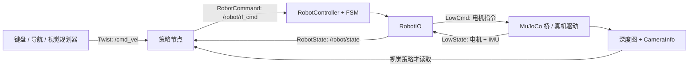

# 16 自由度轮腿控制框架：实现、策略接入与参数调整笔记


当前代码已拆分：`wheel_leg_mujoco` 负责仿真，`himloco_policy` 负责策略，`robot_ctrl` 负责 FSM 和硬件接口。根目录 `launch/` 组合启动三个节点；独立启动、配置文件归属和 sim2real 使用方法见 [包结构与启动说明](package_layout.md)。

本文对应 `/home/wangmx/hustrc2027dog` 在 2026-11-14 的代码。以实际实现为准，说明已具备的能力、策略接入边界及调参位置。文中的“盲走”指只依赖本体感知的运动策略。

## 1. 能接哪些策略

**控制层已经与模型推理解耦，适合接入多种策略；目前自带的推理节点是 HIM Go2W 专用实现，尚未实现通用策略插件、视觉模型部署或多策略选择器。**

| 需求 | 目前情况 | 接入需要做什么 |
| --- | --- | --- |
| HIMLoco flat / parkour 盲走 | 已实现，可启动时选择 profile | 同时选对权重、观测、默认站姿及 PD |
| 同一 HIM 结构的新权重 | 支持指定 `model_path` | 保证训练与部署的全部输入/输出语义一致 |
| 其他盲走网络，如不同观测、ONNX、循环网络 | 控制接口可复用，现有推理节点不能直接通用 | 新增策略节点，构造对应观测、推理并转换为 `RobotCommand` |
| 深度视觉策略 | 有深度图和相机内参接口；当前 HIM 节点未使用图像 | 配置机载相机、预处理、同步、视觉推理及故障处理 |
| RGB / RGB-D 策略 | 当前桥仅发布深度，不发布 RGB | 增加渲染/相机驱动及相应订阅 |
| 视觉规划器 + 盲走控制器 | 接口适合这种组合，未自带视觉规划器 | 规划器发布 `/cmd_vel`，底层保持当前 HIM 策略 |
| MPC / 手写控制器 | 可走相同电机接口 | 自己生成 16 路目标并遵守会话、时效和轮速度控制约定 |
| 运行中多策略切换 | 尚无选择器、输出仲裁或平滑过渡 | 先使用停用旧节点、完成 Stand、启用新节点的显式流程 |
| 其他自由度或其他机器人 | 当前仍固定为 16 电机 Go2W | 修改消息、关节映射、轮索引、限位、控制器和仿真适配 |

“支持不同策略接入”表示控制接口能够承载这些策略，并不表示已有任意模型自动适配功能。当前 `model_path` 不能自动推断观测顺序、动作类型、关节顺序或训练 PD。

## 2. 整体数据流与核心代码



| 文件，均相对工作空间根目录 | 阅读重点 |
| --- | --- |
| `src/wheel_leg_interfaces/msg/RobotState.msg` | 统一反馈、控制模式、会话号、IMU |
| `src/wheel_leg_interfaces/msg/RobotCommand.msg` | 外部策略的统一电机输出 |
| `src/robot_ctrl/src/control/RobotController.cpp` | 200 Hz 主循环、ROS2 回调、倾角/超时保护、最终输出 |
| `src/robot_ctrl/include/FSM/FSMState.h` | 三个状态共用的 enter/run/exit/checkChange 接口 |
| `src/robot_ctrl/src/FSM/FSM.cpp` | 当前状态、生命周期切换、会话号与周期指令清零 |
| `src/robot_ctrl/src/FSM/State_Passive.cpp` | Passive 阻尼目标 |
| `src/robot_ctrl/src/FSM/State_Stand.cpp` | Stand 起点记录、时间插值和完成条件 |
| `src/robot_ctrl/src/FSM/State_RL.cpp` | RL 指令检查、缓存、首条指令前保持站姿及退出清理 |
| `src/robot_ctrl/src/interface/RobotIO.cpp` | LowState 输入、LowCmd 输出、IMU 转换、相机缓存 |
| `src/himloco_policy/himloco_policy/policy_node.py` | ROS2 状态/速度订阅、推理、指令发布 |
| `src/himloco_policy/himloco_policy/policy_core.py` | 不依赖 ROS/Torch 的观测拼接与动作解释 |
| `src/himloco_policy/scripts/export_policy` | HIM actor 与 estimator 的组合导出和数值验证 |
| `src/wheel_leg_mujoco/wheel_leg_mujoco/mujoco_node.py` | 仿真 ROS2 驱动、深度发布、命令断流处理 |
| `src/wheel_leg_mujoco/wheel_leg_mujoco/mujoco_backend.py` | 关节地址映射、PD 力矩、物理步进、IMU |
| `src/robot_ctrl/scripts/keyboard_control` | 键盘到机体期望速度 |
| `launch/sim2sim.launch.py` | 节点组合和参数覆盖顺序 |
| `src/himloco_policy/config/parkour.yaml` | parkour 策略动作基准与 RL PD |

职责边界：策略负责“怎么看状态、如何推理、动作如何变成目标”；控制器负责“何时允许执行、是否超时、如何退出”；驱动负责“把统一物理量转换到底层协议并执行”。仿真与真机共享前两层。

## 3. 电机、状态和 ROS2 接口约定

### 3.1 固定的 16 电机顺序

| 内部索引 | 腿 | 关节顺序 |
| --- | --- | --- |
| 0、1、2、3 | FL 左前 | hip、thigh、calf、wheel |
| 4、5、6、7 | FR 右前 | hip、thigh、calf、wheel |
| 8、9、10、11 | RL 左后 | hip、thigh、calf、wheel |
| 12、13、14、15 | RR 右后 | hip、thigh、calf、wheel |

代码中的轮关节名使用 `foot_joint`，策略逻辑中的轮索引是 `3, 7, 11, 15`。`RL` 作为腿名时是左后腿，作为控制模式时是策略控制状态。

角度 `q` 用 rad，角速度 `dq` 用 rad/s，力矩 `tau` / `tau_est` 用 Nm。统一关节方向和零点必须与训练资产一致。

`RobotIO` 中的 `motor_mapping[i]` 表示“统一第 i 个电机对应底层 LowCmd/LowState 的哪个槽位”。底层消息有 20 个槽位，映射需要 16 个不同的 `[0,19]` 索引。这个参数只改变排列，**不会改变关节方向、零点、减速比或单位**。

当前内置 MuJoCo 桥固定使用前 16 个槽位，所以配套使用恒等映射。真机驱动若使用其他槽位，可以调整控制器映射；不要在内置桥仍使用默认槽位时单方面更改映射。

### 3.2 Topic 方向

下表默认值来自 `sim2sim.launch.py`；`dog_mujoco.launch.py` 将底层电机和相机 topic 默认放在 `/sim` 下。

| Topic | 类型 | 发布者 → 订阅者 | 用途 |
| --- | --- | --- | --- |
| `/lowcmd` | `unitree_go/msg/LowCmd` | 控制器 → 仿真/真机驱动 | 电机最终指令 |
| `/lowstate` | `unitree_go/msg/LowState` | 驱动 → 控制器 | 电机反馈及 IMU |
| `/robot/state` | `wheel_leg_interfaces/msg/RobotState` | 控制器 → 策略 | 整理后的统一状态 |
| `/robot/imu` | `sensor_msgs/msg/Imu` | 控制器 → 调试/其他节点 | 独立转发的 IMU |
| `/robot/rl_cmd` | `wheel_leg_interfaces/msg/RobotCommand` | 当前策略 → 控制器 | 16 路策略目标 |
| `/robot/mode` | `std_msgs/msg/String` | 操作者/启动逻辑 → 控制器 | `passive`、`stand`、`rl` |
| `/cmd_vel` | `geometry_msgs/msg/Twist` | 键盘/导航 → 策略 | 机体 `vx, vy, wz` |
| `/camera/depth/image_raw` | `sensor_msgs/msg/Image` | 相机/仿真 → 视觉节点及缓存 | 原始深度 |
| `/camera/depth/camera_info` | `sensor_msgs/msg/CameraInfo` | 相机/仿真 → 视觉节点及缓存 | 图像内参 |

底层电机、相机和速度 topic 可通过已有参数修改；`/robot/state`、`/robot/rl_cmd`、`/robot/mode`、`/robot/imu` 在源码中使用固定绝对名称，可用 ROS2 remapping 改名。修改名字不会转换消息类型。

反馈与图像订阅使用 SensorData QoS，可接受 best effort 传感器发布。当前策略状态和电机目标使用 depth=1 的可靠队列。外部节点应匹配 QoS，图像订阅可直接使用 `qos_profile_sensor_data`。

### 3.3 RobotState 的时效与会话

`RobotState` 包括 `control_mode`、`control_session`、16 电机状态和 `sensor_msgs/Imu`。

- `control_mode`：0=PASSIVE、1=STAND、2=RL。
- `control_session`：每次实际切换模式递增，策略必须回传最近收到的会话号。
- `header.stamp`：`RobotIO` 收到有效 LowState 的 ROS 时间，控制器转发时不会刷新。当前 LowState 没有独立的采样时间戳，因此不能靠此字段发现驱动反复重发的旧采样。
- 控制器用单调时钟检查反馈断流；策略既检查消息到达间隔，也检查 header 的年龄。

模式变更后，策略应清空观测历史、上一动作以及可能存在的 RNN 隐藏状态。会话号解决跨模式残留指令问题，不区分同一会话里的不同策略发布者。

### 3.4 RobotCommand 的最低契约

外部策略需要填满 16 路指令，`header.stamp` 使用与控制器相同的 ROS 时钟，`control_session` 复制当前状态值。

```python
# 以下是输出转换片段；q_des/dq_des/kp/kd 来自策略自己的动作解释器。
output = RobotCommand()
output.header.stamp = self.get_clock().now().to_msg()
output.control_session = state.control_session
for i in range(16):
    m = output.motor_cmd[i]
    m.mode = 1
    m.q = float(q_des[i])
    m.dq = float(dq_des[i])
    m.kp = float(kp[i])
    m.kd = float(kd[i])
    m.tau = 0.0
self.command_pub.publish(output)
```

`State_RL.receive()` 的现有硬性检查如下；不符合时，控制器转入 Passive，而不是裁剪后继续：

| 字段 | 接收范围/约定 |
| --- | --- |
| `q/dq/kp/kd/tau` | 全部必须有限，禁止 NaN/Inf |
| 每路 `mode` | 必须为 1 |
| `kp` | 0～100 |
| `kd` | 0～10 |
| `abs(q)` | ≤5 rad |
| `abs(dq)` | ≤100 rad/s |
| `abs(tau)` | ≤40 Nm，检查的是前馈项 |
| 四个轮电机 | 另外要求 `q=0`、`kp=0` |

这些范围是接收规则，不代表电机额定能力，也不构成完整的力矩或关节限位保护。`RobotCommand` 允许腿设置位置、速度和前馈力矩；当前 HIM 适配器将腿解释为位置控制，轮解释为速度控制。轮位置控制需要修改现有协议校验。

外部策略不能只发 12 路腿目标而让四个轮字段全为默认值：默认 `mode=0` 会被拒绝。12 动作网络必须显式为轮生成符合约定的四路指令，并确认训练时的机器人接触/轮行为与部署相容。

## 4. 控制层如何工作

### 4.1 Passive → Stand → RL

入口为 `RobotController.update()`，默认 `control_period=0.005 s`，即 200 Hz。

1. 检查有效底层反馈是否超时，失效则进入 Passive。
2. 对非 Passive 状态检查总倾角；由四元数计算 `1-2*(qx²+qy²)`，小于 0.5 表示机体 z 轴倾角超过 60°。
3. 检查 RL 指令是否超时。
4. `FSM.run()` 清空周期指令后，调用当前状态的 `run()` 生成目标。
5. 发送前再次按反馈可用性覆盖：无反馈时全部电机 `mode=0`；随后经 `RobotIO.sendMotorCommand()` 发送。
6. 反馈有效时发布状态、模式和 FSM 维护的当前会话。

**Passive**：有有效反馈时腿使用 `kd=1`、轮使用控制器的 `wheel_kd` 施加阻尼，位置增益为零；反馈失效时 `mode=0`、`kd=0`。Passive 不等于所有情况下都断电，也不保证机器人维持站姿。

**Stand**：记录进入时的实测角度，在 `stand_duration=1.5 s` 内线性插值到 `default_position`。腿使用控制器 PD，轮保持目标速度 0 和速度阻尼。

**RL**：仅允许从已完成 Stand 的状态进入。进入后在 `policy_timeout` 内等待第一条指令，期间继续保持站姿；随后每个控制周期复用最近一条合法策略指令。策略默认 50 Hz，控制器默认 200 Hz，并未对相邻动作插值。

`State_RL` 是显式 FSM 状态，负责策略指令检查、缓存与输出，未收到首条指令时保持最终站姿，退出时清除缓存。模型推理仍在独立 Python 节点中。

### 4.2 不同超时的区别

| 参数位置 | 默认 | 超时后的行为 |
| --- | --- | --- |
| `robot_ctrl.state_timeout` | 0.1 s | 底层反馈不可用，转 Passive 并禁用电机输出 |
| `robot_ctrl.policy_timeout` | 0.2 s | RL 指令断流，转 Passive |
| `himloco_policy.state_timeout` | 0.1 s | 暂停推理/发布，随后控制器可能因策略超时退出 RL |
| `himloco_policy.command_timeout` | 0.5 s | 期望速度归零，仍继续 RL 以维持平衡 |
| `go2w_mujoco.command_timeout` | 0.1 s | 不再使用旧 LowCmd，改用后端的默认阻尼命令 |
| `keyboard_control.key_timeout` | 0.5 s | 对应速度轴在无按键重复时归零 |

过旧、未来超过 50 ms、数值非法或会话错误的 RL 指令会使控制器退出 RL。没有策略所有权检查、碰撞急停、路径规划或完整硬件故障管理。策略节点发生故障后不会自动反复启动运动。

### 4.3 显式 FSM 的组织与生命周期

当前采用一个 FSM 管理三个常驻状态对象，状态类均实现 `FSMState`：

| 函数 | 调用时机 | 当前用途 |
| --- | --- | --- |
| `enter(state, session)` | 真正切换到该状态时调用一次 | Stand 记录起始反馈/时间；RL 清空旧动作并保存新会话 |
| `run(command)` | 每个 200 Hz 控制周期调用 | 生成该状态的 16 电机目标 |
| `exit()` | 离开旧状态时调用一次 | RL 清理缓存；Passive/Stand 当前无需额外清理 |
| `checkChange(requested)` | 请求切换时调用 | 返回允许的下一状态，条件不满足时保持当前状态 |

`FSM.changeMode()` 先校验目标状态及当前状态的切换条件；若确实发生变化，执行 `旧状态.exit() -> 更新模式和会话号 -> 新状态.enter()`。重复请求当前状态不会重新 enter、递增会话或重启 Stand 插值。模式回调仅在当前是 Stand 时接受 `rl` 请求。

| 当前状态 | 允许的切换 |
| --- | --- |
| Passive | Stand；不能直接进入 RL |
| Stand | Passive；插值时间完成后可以进入 RL |
| RL | Passive 或 Stand |

所有状态都允许转 Passive。反馈是否有效由 `RobotController` 在接受非 Passive 请求前检查；反馈超时、倾角超限、策略超时以及非法策略指令也通过同一个 FSM 切换入口回到 Passive。

`FSM.run()` 每周期先创建空的 `RobotCommand`，防止旧的 kp、dq、tau 泄漏到新状态。状态输出后，控制器在反馈失效时将指令覆盖为全零的禁用输出。常规 Passive 阻尼不会重新使能失联电机。

三个状态通过 `ControllerConfig` 的只读引用共享启动配置，配置值由控制器加载，ROS2 参数名和 profile 叠加顺序保持原样。`State_Stand` 在每次 enter 时重新记录起点，因此 RL -> Stand -> RL 会重新完成站立过渡；`State_RL` 在 enter 和 exit 时清除旧指令，防止再次进入时回放上一会话动作。

接入新的高层状态时，增加实现 `FSMState` 的类，在 `FSM` 中注册对应对象和枚举，并明确各状态的切换条件；同时更新消息里的模式常量和外部消费者。底层收发和全局保护继续集中在控制器。接入不同的 RL 网络通常只需要外部策略适配，不必为每个模型新增一个 FSM 状态。

## 5. 当前 HIMLoco 推理的具体实现

### 5.1 57 维单帧 × 6 帧历史

`HimPolicyCore.observe()` 按以下顺序拼接；张量为 float32。

| 单帧下标，左闭右开 | 内容 | 缩放 |
| --- | --- | --- |
| `[0:3]` | 机体期望 `vx, vy, wz` | `[2.0, 2.0, 0.25]` |
| `[3:6]` | 机体角速度 `wx, wy, wz`，rad/s | 0.25 |
| `[6:9]` | 重力单位向量在机体坐标系的投影 | 由姿态计算 |
| `[9:25]` | 实测关节角减默认角 | 1.0；四轮对应项强制为 0 |
| `[25:41]` | 16 关节角速度 | 0.05 |
| `[41:57]` | 上次裁剪后的 16 维原始动作 | 不再做物理量缩放 |

所有观测最终按 `clip_observations=100` 裁剪。历史排列是 `[当前帧, 上一帧, ...]`，进入新会话时旧帧和上一动作全零。输入形状为 `[1,342]`，模型输出 `[1,16]`。

当前输入不包含加速度计、深度图、绝对机体高度或直接测量的机体线速度。轮角累计值不作为位置观测，但四轮速度仍保留。

### 5.2 导出时保留了什么

`ExportedHim.forward()` 实现：

```text
history[342]
  -> estimator.encoder
  -> 估计线速度 + 归一化潜变量
  -> 与当前 57 维观测拼接
  -> actor
  -> action[16]
```

HIM 的状态估计器是部署推理的一部分，不能只拿 actor 文件替换整个导出模型。训练时 critic 使用的特权地形观测并不意味着部署 actor 直接读取深度图；当前 parkour 导出模型是盲走模型。`export_policy` 会将导出结果与训练代码的 `act_inference()` 做数值对照。

### 5.3 动作如何成为电机目标

```text
a = clip(network_output, -clip_actions, clip_actions)
腿: q_des = default_position + 0.25 * a，dq_des = 0
轮: q_des = 0，dq_des = clip(10 * a, -100, 100)，kp = 0
```

腿目标还会按当前 Go2W 的硬编码关节范围裁剪。前后腿 thigh 范围不同，见 `action_to_targets()`；这不是通过 XML 动态读取的配置。`last_action` 保存裁剪后的网络动作，并非由最终目标反算的动作。

动作缩放属于训练与部署契约。想让车体快一些应先调整 `/cmd_vel`；直接增大 `wheel_action_scale`、`leg_action_scale` 或观测缩放，可能破坏闭环。

### 5.4 flat 和 parkour 配套参数

| 项目 | flat | parkour |
| --- | --- | --- |
| 模型 | `policies/flat.pt` | `policies/parkour.pt` |
| hip 默认角 | 左 +0.1，右 -0.1 | 四腿 0 |
| thigh 默认角 | 前 0.8，后 1.0 | 四腿 0.8 |
| calf 默认角 | -1.5 | -1.5 |
| 腿 kp / kd | 20 / 0.5 | 40 / 1.0 |
| 轮 kp / kd | 0 / 0.3 | 0 / 0.5 |
| 仿真初始高度 | 0.42 m | 0.45 m |
| 策略周期 | 0.02 s | 0.02 s |

统一 launch 默认 parkour。独立 `ros2 run` 的原始节点默认仍偏向 flat，因此手动组合节点时要加载对应 profile。`himloco_policy.policy_profile` 参数本身只是日志标签，真正的配置和文件选择由 launch 完成；运行时只修改这个字符串不会切换模型。

## 6. 外部盲走策略的接入方法与示例

### 6.1 情况 A：仅更换兼容的 HIM Go2W 权重

适用条件：同样的 57 维单帧、6 帧顺序、16 动作排列，且 PD、默认角度、归一化、动作解释、控制周期全部一致。输入输出形状相同只是必要条件。

```bash
cd ~/hustrc2027dog
source /opt/ros/humble/setup.bash
source install/setup.bash
source .venv/bin/activate

# 将本地 HIM checkpoint 导出为包含 estimator 的 TorchScript。
ros2 run himloco_policy export_policy \
  --himloco-root "$HOME/_PaperWorks/HIMLoco" \
  --checkpoint /absolute/path/model_XXXXX.pt \
  --output /absolute/path/my_parkour.pt

# 本例要求新模型参数与现有 parkour profile 一致。
ros2 launch launch/dog_mujoco.launch.py \
  policy_profile:=parkour \
  model_path:=/absolute/path/my_parkour.pt \
  enable_keyboard:=true viewer:=true
```

`model_XXXXX.pt` 和 `my_parkour.pt` 是需要替换的路径。原始 checkpoint 不是 TorchScript，不能直接作为 `model_path`。如果训练改变了配置，需要建立自己的配置组合；当前 launch 的 profile 选项只包含 `parkour` / `flat`。

换不同结构但恰好 `[1,342] -> [1,16]` 的模型，启动时的零输入检查可能通过，仍可能因为动作或坐标语义不同而无法正确控制。

### 6.2 情况 B：观测或动作不同的新策略

建议新建自己的 ROS2 包，例如 `external_policy`。保持简单的 `Node + callback + timer`：

1. 订阅 `/robot/state` 和速度 topic，记录接收时间与原始时间戳。
2. 按训练方式构造观测，处理关节重排、单位、缩放和历史/RNN 状态。
3. 使用自己的 TorchScript、ONNX 或其他推理后端。
4. 将动作转换成统一 16 路 `q/dq/kp/kd/tau`，并做模型对应的限位。
5. 复制当前 `control_session`，发布 `/robot/rl_cmd`。
6. 只在 RL 模式、状态新鲜、推理输出有限时发布。推理超时不再发布旧结果。

可参考现有 `HimLocoPolicy.update()` 的时效与会话处理。**不要为了接入新网络而让策略直接发布 `/lowcmd`，否则会绕开控制器的模式和检查。**

下面是架构片段，并非已安装的新节点；`build_observation`、`infer`、`decode_action` 是要按训练实现的三个函数：

```python
# imports: time、numpy as np，以及 RobotState、RobotCommand。
# state_callback 记录 self.state 和 time.monotonic()。
# velocity_callback 记录机体 vx/vy/wz 及到达时间。

def update(self):
    if self.state is None:
        return
    state = self.state
    current = time.monotonic()
    if current - self.state_time > self.state_timeout:
        return
    stamp = state.header.stamp.sec + state.header.stamp.nanosec * 1e-9
    age = self.get_clock().now().nanoseconds * 1e-9 - stamp
    if age < -0.05 or age > self.state_timeout:
        return

    session = (state.control_mode, state.control_session)
    if session != self.session:
        self.reset_policy_memory()  # 历史、last_action、RNN hidden state
        self.session = session
    if state.control_mode != RobotState.RL:
        return

    velocity = np.zeros(3)
    if current - self.command_time < self.command_timeout:
        velocity = self.command.copy()
    observation = self.build_observation(state, velocity)
    action = self.infer(observation)
    q_des, dq_des, kp, kd, tau = self.decode_action(action)
    arrays = [q_des, dq_des, kp, kd, tau]
    for value in arrays:
        if np.shape(value) != (16,) or not np.isfinite(value).all():
            self.set_mode("passive")
            return
    if time.monotonic() - self.state_time > self.state_timeout:
        return

    output = RobotCommand()
    output.header.stamp = self.get_clock().now().to_msg()
    output.control_session = state.control_session
    for i in range(16):
        m = output.motor_cmd[i]
        m.mode = 1
        m.q, m.dq = float(q_des[i]), float(dq_des[i])
        m.kp, m.kd = float(kp[i]), float(kd[i])
        m.tau = float(tau[i])
    self.command_pub.publish(output)
```

这段示意按当前单线程同步推理方式编写，完整实现还需要异常处理、合法范围检查和订阅/发布初始化。异步推理还应在发布前确认最新会话仍等于推理启动时的会话，丢弃过期任务。循环网络要按训练方式维护隐藏状态，不能机械地复用 HIM 的六帧历史。

不同动作类型的适配：

| 网络输出 | 转换方法 |
| --- | --- |
| 腿位置偏移 + 轮速度 | 参考 `HimPolicyCore.action_to_targets()`，用本模型训练的缩放和默认角 |
| 绝对关节位置 | 直接构造腿 `q_des`，不要再次叠加默认角；轮仍按速度协议适配 |
| 残差力矩 | 将残差放入 `tau`，明确是否还叠加 PD；核对总力矩限制 |
| 纯力矩 | 所有 `kp/kd=0`，动作转为 `tau`，轮 `q=0`；检查前馈范围和仿真等待条件 |
| 不同关节排列 | 在策略适配层重排成 FL/FR/RL/RR，再做动作解释 |

纯力矩策略的额外细节：桥的 `wait_for_controller=true` 只在收到任意 `kp>0` 后开始物理步进。按正常 Stand → RL 流程已经可以解除等待；若另写了绕过 Stand 的独立测试，则需要显式配置 `wait_for_controller=false`。现有控制器本身仍要求完成 Stand 后才能进入 RL。

### 6.3 如何启动自己的策略而不同时运行 HIM

`start_simulator:=false` 只关闭内置仿真，**不会关闭 HIM 节点**；`autostart:=false` 也只是关闭 HIM 的自动状态切换，不会禁止它在 RL 时发布动作。统一 launch 可用 `start_policy:=false` 关闭 HIM 节点。

接入自己的策略时，可用 `ros2 launch launch/dog_mujoco.launch.py start_policy:=false` 启动主控和仿真，再运行自己的策略；也可以分开启动控制器、桥和自己的节点。以下三组命令在不同终端执行，每个终端先 source ROS、工作空间和 `.venv`，工作目录为工作空间根目录。

```bash
# 终端 1：只启动控制器，加载 parkour 作为本例站立配置。
ros2 run robot_ctrl robot_ctrl --ros-args \
  --params-file src/robot_ctrl/config/go2w.yaml \
  --params-file src/robot_ctrl/config/parkour.yaml \
  -p motor_command_topic:=/sim/lowcmd \
  -p motor_state_topic:=/sim/lowstate \
  -p depth_topic:=/sim/camera/depth/image_raw \
  -p camera_info_topic:=/sim/camera/depth/camera_info
```

```bash
# 终端 2：只启动 ROS2 MuJoCo 桥。
ros2 run wheel_leg_mujoco go2w_mujoco --ros-args \
  --params-file src/wheel_leg_mujoco/config/parkour.yaml \
  -p motor_command_topic:=/sim/lowcmd \
  -p motor_state_topic:=/sim/lowstate \
  -p viewer:=true
```

```bash
# 终端 3：这里是你创建的包和可执行程序，当前仓库未提供这个名字的节点。
ros2 run external_policy external_policy_node --ros-args \
  --params-file /absolute/path/external_policy.yaml
```

外部节点准备好并持续接收状态后，再发送模式切换；默认 Stand 至少需要 1.5 s：

```bash
ros2 topic pub --once /robot/mode std_msgs/msg/String '{data: stand}'
# 观察站立完成后，另行执行下一条。
ros2 topic pub --once /robot/mode std_msgs/msg/String '{data: rl}'
```

想先验证“分开启动”的流程，可用已安装的 HIM 节点替代终端 3 的占位命令；以下是可用的实际入口：

```bash
ros2 run himloco_policy himloco_policy --ros-args \
  --params-file src/himloco_policy/config/himloco.yaml \
  --params-file src/himloco_policy/config/parkour.yaml \
  -p policy_profile:=parkour \
  -p model_path:="$PWD/src/himloco_policy/policies/parkour.pt" \
  -p autostart:=false
```

### 6.4 多策略之间如何切换

当前没有策略 ID 或优先级，两个发布者在相同会话下同时发送合法 `/robot/rl_cmd` 会交替覆盖。不要把 topic 能连接多个节点理解为已经实现安全的策略切换。

现有实现建议使用显式流程：发送 `stand`，确认退出 RL；停止旧策略输出；启动新策略并确认状态和模型准备完成；待 Stand 完成后发送 `rl`。新节点会使用新的会话和空历史。`stand` 的进入会重置插值时间，切换流程应给足 `stand_duration`。

如需运行中平滑切换，应另做策略选择器：候选策略发布各自 topic，选择器只将选中的一路发给控制器，并处理会话、时效、准备状态和动作过渡。当前仓库没有这个组件。真机紧急退出与普通策略交接的处理也应分别设计。

## 7. 视觉策略接入

### 7.1 图像已经到哪里

`Go2WMujoco.setup_depth()` 在 `enable_depth=true` 时创建渲染器，默认查找名为 `front_depth` 的 MJCF camera。`publish_depth()` 发布：

| 项目 | 当前实现 |
| --- | --- |
| 图像 | 默认 320×240，`32FC1`，单位 m，小端 |
| 图像周期 | 固定 15 Hz，不是策略的 50 Hz |
| 内参 | 由 camera 的 fovy 与图像大小生成 K/P，零畸变 |
| frame_id | 固定 `front_depth_optical` |
| 外参 | 未发布 TF，未自动获取/转换为策略输入 |
| 时间 | 渲染发布时的 ROS 时间；未实现与电机反馈同步 |
| 控制器相机接口 | 仅缓存最新 Image 与 CameraInfo，无时效检查 |
| HIM 推理 | 不读取这些缓存，也不订阅图像 |

C++ 中 `RobotIO::getDepthImage()` 和 `getDepthCameraInfo()` 可访问缓存，未收到时为空指针。Python 视觉策略应直接订阅相同相机 topic，不能直接调用另一个进程的 C++ getter。

机器人和平地、障碍场景及关联网格已随 `wheel_leg_mujoco` 包安装；启动文件和仿真节点通过 ROS2 包索引查找资源，无需外部仿真仓库。`start_sim.sh` 默认加载本仓库源码中的障碍场景，`model_xml` 仍可指定其他 XML。

目前障碍场景 `src/wheel_leg_mujoco/models/go2w/urdf/scene_fields.xml` 只有 `course_overview`、`course_top` 等场地相机，没有 `front_depth`。直接加 `enable_depth:=true` 会因缺少命名相机启动失败。选场地俯视相机虽然可能出图，但不等于训练中的机载视觉输入。

### 7.2 补齐机载相机

应在自己的 MJCF 副本中、机器人 `base` body 下加入相机，并保持 mesh/include 路径可解析。下面仅展示朝前相机的写法，位置和 FOV 应替换成模型训练时的值：

```xml
<!-- 放在 base body 内；此例相机朝机体 +X，图像右向机体 -Y。 -->
<camera name="front_depth"
        pos="0.25 0 0.05"
        xyaxes="0 -1 0 0 0 1"
        fovy="60"/>
```

验证时要确认：确实挂在运动的机体上；前方物体出现在图像正确位置；深度尺度正确；机身不会大面积遮挡视野；相机安装旋转与训练一致。不要只用 frame_id 判断相机坐标已经正确。当前未发布 TF，需要由模型约定或额外节点提供一致的外参。

组合 launch 只直接暴露 `enable_depth` 和 topic，不暴露 `depth_camera/depth_width/depth_height`；单独运行桥可设置这些参数，定制 launch 也可显式传入：

```bash
# 此 XML 必须已经包含你添加的机载相机；该命令只启动仿真桥。
ros2 run wheel_leg_mujoco go2w_mujoco --ros-args \
  --params-file src/wheel_leg_mujoco/config/parkour.yaml \
  -p model_xml:=/absolute/path/scene_with_front_camera.xml \
  -p motor_command_topic:=/sim/lowcmd \
  -p motor_state_topic:=/sim/lowstate \
  -p enable_depth:=true \
  -p depth_camera:=front_depth \
  -p depth_width:=320 -p depth_height:=240 \
  -p depth_topic:=/sim/camera/depth/image_raw \
  -p camera_info_topic:=/sim/camera/depth/camera_info
```

OpenGL 渲染环境仍需可用。换相机名称后，桥的 frame_id 当前不会随参数一起改变，需要检查相应代码/TF 定义。不得同时再启动另一个驱动使用同一组电机 topic。

### 7.3 举例：本体历史 + 深度图的双输入网络

假设你训练的模型明确约定：`forward(history[1,342], depth[1,1,48,64]) -> action[1,16]`，并且本体观测、动作语义与当前 HIM 一致。这里的 48×64 只是示例，不是当前 parkour 模型的输入。

需要将原先的单输入推理替换为如下步骤：

```python
# 新视觉节点初始化时：
from rclpy.qos import qos_profile_sensor_data
self.depth_sub = self.create_subscription(
    Image, depth_topic, self.depth_callback, qos_profile_sensor_data)
self.info_sub = self.create_subscription(
    CameraInfo, camera_info_topic, self.camera_info_callback,
    qos_profile_sensor_data)

# 推理时，示意：
# 1. 校验 state/depth 的年龄和两者时间差，拒绝未就绪或过旧图像。
# 2. 根据训练约定构造 history 与深度张量。
history = self.core.observe(position, velocity, quaternion_wxyz, gyro, command)
depth_tensor = self.preprocess_depth(self.depth_message)
with torch.no_grad():
    action = self.model(torch.from_numpy(history), depth_tensor)
# 3. 校验 action 为有限的 [1,16]，转换目标并按第 3.4 节发布。
```

这不是现有 `HimLocoPolicy` 的直接配置项；其构造函数会按单个 `[1,342]` 输入检查模型。视觉节点应修改加载时的检查及推理调用，而不只是指定视觉模型路径。若本体观测不同，也要替换 `HimPolicyCore`。

读取 `32FC1` 原始图像时应尊重 `step` 和端序。下面函数可读当前仿真图像，也能处理每行 padding；它只解码，不包含模型相关预处理：

```python
import numpy as np

def decode_depth_32fc1(message):
    if message.encoding != "32FC1":
        raise ValueError("This decoder requires 32FC1 depth in metres")
    if message.height <= 0 or message.width <= 0:
        raise ValueError("Invalid depth size")
    if message.step < message.width * 4:
        raise ValueError("Invalid row stride")
    if len(message.data) < message.height * message.step:
        raise ValueError("Incomplete depth buffer")
    dtype = np.dtype(">f4" if message.is_bigendian else "<f4")
    view = np.ndarray(
        shape=(message.height, message.width), dtype=dtype,
        buffer=message.data, strides=(message.step, 4))
    return view.astype(np.float32, copy=True)
```

真实相机若使用 `16UC1`，需按驱动定义的深度比例换算成 m，不能直接套用这个函数，也不要默认所有 `16UC1` 都用同一比例。

视觉预处理必须从训练代码复现：无效值如何处理、近远裁剪、裁剪区域、resize 方法、深度/逆深度、归一化、通道维和历史图像更新频率。裁剪/resize 后若模型使用内参，K/P 也应相应调整。需要 RGB 的策略还要补 RGB 输出与色彩顺序转换。

### 7.4 图像频率、同步和退化行为

当前相机 15 Hz、策略 50 Hz，多个策略周期复用同一深度帧是可能的。应匹配训练中的图像刷新节奏，不能把“重复帧”当成 50 Hz 新图像。

视觉节点至少记录图像到达时间与 header 时间，并检查与 RobotState 的时间差。允许的年龄和同步窗口根据训练延迟、传感器速率和网络实测时延确定；当前仓库没有统一的图像阈值参数。

图像缺失时可以停止发布并让控制器超时退出，也可以明确请求 Passive，或者切换到单独验证过的盲走策略。把深度张量填零继续推理只有在训练覆盖这种情况时才有依据；框架不会自动完成这种退化切换。

### 7.5 举例：视觉规划 + 现有盲走

如果视觉模块只需要决定行进速度和方向，可以保持当前 HIM 不变，由视觉节点输出 `/cmd_vel`：

```text
深度 / RGB -> 障碍判断或局部规划 -> Twist(vx,vy,wz)
          -> 当前 HIM 盲走节点 -> RobotCommand -> 控制器
```

这条路径更适合“视觉负责选路线、现有策略负责运动”的需求；是否能攀越具体障碍仍取决于底层策略能力。使用时关闭键盘发布，或给不同速度源加选择器，避免多个 `/cmd_vel` 发布者相互覆盖。

## 8. IMU：坐标、单位、缩放和调整方法

### 8.1 当前数据路径

```text
MuJoCo imu_state() / 真机驱动
  -> LowState.imu_state
  -> RobotIO.motorStateCallback()
  -> RobotState.imu 和 /robot/imu
  -> HimPolicyCore.observe()
```

`LowState.imu_state.quaternion` 数组为 `[w,x,y,z]`，`RobotIO` 归一化后写入 ROS 的具名字段 `orientation.x/y/z/w`。策略再显式取回 `[q.w,q.x,q.y,q.z]`。直接把两个接口当成相同的四元素数组拷贝会出错。

部署约定：机体 +X 前、+Y 左、+Z 上；姿态表示机体到世界的旋转，陀螺仪在机体轴上，单位 rad/s，加速度为 m/s²。真机驱动应输出与训练一致的世界/机体约定。

`RobotIO` 只做有限值检查、四元数范数检查与归一化、字段排列转换。当前没有：

- IMU 安装旋转、轴交换或轴符号参数。
- deg/s 到 rad/s、g 到 m/s² 的自动单位转换。
- 零偏估计、姿态融合、低通滤波或可配置噪声。
- IMU 物理量程/灵敏度配置，或基于 covariance 的观测加权。

这些功能需要在实际传感器驱动或独立适配节点实现，不能通过改 topic 名完成。

### 8.2 仿真 IMU 为何使用 XBODY

`MujocoRobot.imu_state()` 使用 `data.xquat[base_id]` 作为姿态，并以 `mjOBJ_XBODY`、`local=1` 获取 base 坐标系角速度和加速度。原先使用 `mjOBJ_BODY` 时，局部惯性主轴与姿态所代表的机体轴可能不一致，已经造成过侧移失稳。不要为了“降低灵敏度”改回旧对象或将 gyro 任意乘一个系数。

`mj_rnePostConstraint()` 后读取的线加速度按比力处理；已有自由落体回归检查。当前无 IMU 噪声或低通。若后续策略使用加速度，还应检查其训练定义究竟是比力还是包含重力的运动学加速度，不能只看字段名称。

### 8.3 真实 IMU 有安装角时

设 `R_bs` 将传感器坐标向量转到机体，`R_ws` 是传感器姿态表示的传感器到世界旋转，则需要：

```text
gyro_base = R_bs * gyro_sensor
acc_base  = R_bs * acc_sensor
R_world_base = R_ws * transpose(R_bs)
```

姿态、角速度和加速度要一起处理。只交换 gyro 轴而不修正姿态，仍会产生矛盾观测。还需核对传感器是否报告姿态的逆旋转以及世界轴约定；上式以本文的旋转定义为前提。

### 8.4 如何检查和调整

1. **先检查排列和单位。** 静止时四元数范数应接近 1，gyro 接近零；已知角速度动作应与 rad/s 数值一致。`RobotIO` 允许输入范数约在 0.5～1.5 内再归一化，但这是拒收范围，不是姿态精度标准。
2. **逐轴检查方向。** 单独正向绕 X/Y/Z 转动，确认对应机体角速度正方向；不要仅检查水平放置时的数值。
3. **检查重力投影。** 水平姿态时策略的 `projected_gravity` 应约为 `[0,0,-1]`；标准正 roll 会使 y 分量为负，正 pitch 会使 x 分量为正。这里用姿态计算重力，不直接读取 accelerometer。
4. **校正驱动零偏和安装角。** 保持静止估计 gyro 偏置，在进入统一状态接口前修正。当前框架没有自动校准流程。
5. **最后才考虑滤波。** 先记录真实数据频率、噪声和延迟，再在驱动中增加可评估的滤波；不要让滤波延迟掩盖动作。当前没有可直接设置的滤波参数。
6. **保留训练观测缩放。** 当前 `angular_velocity_scale=0.25` 是神经网络输入缩放，不是 IMU 硬件灵敏度。更换策略时按新模型训练配置修改；保持同一模型时应优先修正原始物理量。

原始数据核对示例：

```bash
ros2 topic echo /robot/imu --once
ros2 topic echo /robot/state --once
ros2 param get /himloco_policy angular_velocity_scale
```

前两个命令查看反馈本身；第三个命令查看策略参数。传感器是否需要去重力、姿态滤波或不同量程，必须与接入模型及驱动定义对照。

## 9. 电机 PD：执行位置、关键值与调法

### 9.1 PD 到底在哪执行

统一电机命令含位置、速度、增益和前馈：

```text
tau_total = kp * (q_des - q_measured)
          + kd * (dq_des - dq_measured)
          + tau_feedforward
```

`RobotIO.sendMotorCommand()` 只做字段映射、组装 LowCmd、计算 CRC 和 ROS2 发布，不在控制器里算 PD 力矩。仿真由 `MujocoRobot.step()` 用当前物理状态计算；真机应由实际驱动/电机按兼容语义执行。

当前 HIM 策略：

```text
腿: tau = leg_kp*(q_des-q) - leg_kd*dq
轮: tau = wheel_kd*(dq_des-dq)，wheel_kp=0
```

因此腿 `kp` 过大可放大位置误差对应的力矩；`kd` 影响速度误差的阻尼；轮 `kd` 是轮速度跟踪增益。调大轮 `kd` 并不等于直接设定更大的车体速度。

### 9.2 三类配置各自影响哪里

| 配置/代码 | 生效阶段 | 实际作用 |
| --- | --- | --- |
| `robot_ctrl` 的 `leg_kp/leg_kd/wheel_kd/default_position` | Stand、等首条 RL 指令；轮 kd 还用于有反馈的 Passive | 站立插值目标和增益 |
| `himloco_policy` 的同名参数 | 正常 RL | 写入每条 RobotCommand 的增益、动作基准 |
| `go2w_mujoco.default_position/initial_height` | 初始化 | 仿真出生姿态，不是运行中的跟踪目标 |
| MJCF 的 `joint damping/frictionloss/armature` | 所有物理步 | 被动阻力与等效惯性，独立于命令 PD |
| MJCF actuator `ctrlrange` | 仿真 PD 后 | 限制传给执行器的控制值 |

只调 `robot_ctrl.leg_kp`，进入正常 RL 后不会改变策略发来的 kp；只调策略 PD，也不会改变 Stand 的增益。同一个 profile 名称会在三个包中分别选择对应的 YAML：主控保存 Stand 配置，策略保存 RL 动作基准与 PD，仿真保存出生姿态。调整时应配套检查这三个文件。

当前参考 `go2w.xml` 的 hip/thigh/wheel 电机 ctrlrange 为 ±23.7，calf 为 ±35.55；本模型执行器使用对应的力矩控制配置。`State_RL` 的 `abs(tau)<=40` 只检查前馈，不能认为总 PD 力矩被统一限制在 40 Nm。

后端会根据 XML 的 `actuator_ctrllimited` / `actuator_ctrlrange` 做裁剪。若更换 actuator gear、执行器类型或模型 XML，必须重新核对 `data.ctrl` 与关节力矩的关系。真机电流、减速器、驱动限幅也不能照搬仿真数值。

### 9.3 参数调整顺序

**第一步：恢复训练基准。** 当前 parkour 先用腿 40/1.0、轮 0/0.5、腿动作缩放 0.25、轮动作缩放 10、策略 0.02 s。对应权重、默认站姿、IMU 坐标和关节顺序应全部匹配。

**第二步：分别测试 Stand 和 RL。** Stand 本身就抖时，优先查站姿、方向、反馈、站立 PD 和接触模型；Stand 正常但 RL 抖时，优先查策略观测、动作顺序、模型来源、RL PD 和周期。

**第三步：确认是否在饱和。** 记录期望目标、实测 q/dq、最终施加力矩与 actuator 上限；长期贴着上限时，继续增大 kp 不能保证改善跟踪。真机需要从驱动反馈实际电流/力矩。

**第四步：小幅、单变量地验证。** 若前述项正确，再在仿真中以约 10% 的单次变化作为试验起点，每次只调整一类增益，并记录姿态峰值、跟踪误差及力矩。这个比例是试验方法，不是对任意机器人有效的推荐增益。

- 高频位置抖动：核对时间延迟、动作跳变、饱和和接触后，试验降低腿 kp，或适量增加腿 kd；过大 kd 也可能导致迟缓或噪声力矩。
- 腿支撑松软或误差大：先排除力矩受限、错误目标和重力/接触问题，再评估 kp，不能仅凭观感加增益。
- 轮速追踪误差大：先核对目标轮速、滚动方向、接触与饱和，再评估 wheel_kd。
- 左右摆动但前进正常：优先逐轴检查 gyro、重力投影和动作排列；本仓库已有 IMU 坐标错误的实际案例。

每组参数都至少检查零速、前后移动、左右移动和转向，再验证目标障碍。不同工况的增益效果可能不同。不要同时修改 PD、动作缩放和 IMU 缩放，否则难以定位原因。

### 9.4 如何让参数修改真正生效

大多数参数只在节点构造时读取。`HimPolicyCore` 持有配置副本，定时器周期和模型也在初始化时确定；即使 ROS 参数服务器接受某些 `ros2 param set`，也不代表运行逻辑会更新。当前明确支持运行时启停的是键盘 `enable_keyboard`。

推荐方法：

1. 为新策略保留独立 YAML，包含站立、策略及仿真初始姿态的配套参数。
2. 手动 `ros2 run` 时先加载基础参数，再 `--params-file /absolute/path/tuning.yaml`，后面的同名值覆盖前面。YAML 节点名称须与实际节点名匹配。
3. 使用现有统一 launch 时，修改源码对应 profile 后重新构建并重启；或定制 launch，将自定义 ParameterFile 加在基础/profile 后、需要优先的显式参数前。当前没有通用的 `config_path` launch 参数。
4. 重启后核对日志和参数，同时观察 `/robot/rl_cmd` 中真正发布的 `kp/kd`。

例如，`tuning.yaml` 可以先从同一基准开始，之后只改被验证的项：

```yaml
robot_ctrl:
  ros__parameters:
    leg_kp: 40.0
    leg_kd: 1.0
    wheel_kd: 0.5
himloco_policy:
  ros__parameters:
    leg_kp: 40.0
    leg_kd: 1.0
    wheel_kd: 0.5
```

本例只覆盖 PD，不自动覆盖默认角；默认角应从与你模型一致的 profile 加载。若修改默认角，需要同时更新策略动作基准、控制器 Stand 和仿真出生姿态。

```bash
ros2 param get /robot_ctrl leg_kp
ros2 param get /himloco_policy leg_kp
ros2 topic echo /robot/rl_cmd --once
```

第一个值表示控制器参数，正常 RL 的实际增益应核对第三条输出；外部策略也可能按每个关节发布不同增益。

## 10. 速度、控制周期和仿真参数

### 10.1 提高移动速度

键盘模式通过 `keyboard_linear_speed` 设置前后/左右期望速度，默认 0.3 m/s。例如：

```bash
ros2 launch launch/dog_mujoco.launch.py \
  policy_profile:=parkour enable_keyboard:=true \
  keyboard_linear_speed:=0.6 viewer:=true
```

外部导航则持续发布 `Twist.linear.x`、`linear.y` 和 `angular.z`。当前节点只检查有限值，没有按训练范围自动限幅。parkour 配置中的基础采样范围为 x ±1.0 m/s、y ±0.6 m/s、yaw ±1.0 rad/s；训练还包含 curriculum，不能仅凭这几个范围断言具体 checkpoint 覆盖了所有速度工况。

命令缩放 `command_scale`、动作缩放、轮速限制、轮半径与车体期望速度是不同概念。改变控制周期或加快物理步进也不是提高期望移动速度的方法。

### 10.2 周期之间的关系

| 项目 | 当前默认 | 修改位置 |
| --- | --- | --- |
| 控制层周期 | 0.005 s / 200 Hz | `robot_ctrl.control_period` |
| 仿真物理步长和桥定时器 | 0.005 s / 200 Hz | `go2w_mujoco.simulation_period` |
| 策略周期 | 0.02 s / 50 Hz | `himloco_policy.policy_period` |
| 深度渲染 | 15 Hz | `setup_depth()` 内硬编码 |
| 键盘发布 | 0.05 s / 20 Hz | `keyboard_control.publish_period` |

训练使用 `dt=0.005`、`decimation=4`；部署以独立 ROS 定时器近似同样的 4:1 比例，并没有用同一个物理步计数器严格锁定推理。

当前桥每个回调推进一个物理步，不发布 `/clock`，未完成基于仿真时钟的整体调度。直接把所有节点设为 `use_sim_time=true` 不会自动得到可用的同步系统。保持当前一致的 ROS 时钟；若后续增加 `/clock`，要同时检查消息 stamp、定时器和基于单调时钟的超时设计。

渲染、推理或 ROS 调度慢时，仿真时间可能落后于真实时间。应先测实际反馈/策略频率、CPU、渲染耗时和丢帧；当前推理设置了单线程 CPU。调整步长还会改变接触/数值行为，需要重新验证，不能把它当作单纯性能旋钮。

### 10.3 键盘参数

方向键：上/下对应 ±vx，左/右对应 ±vy；`,` / `.` 对应 ±wz，空格清零。每个轴独立超时，允许平移与转向组合。速度约定在机体坐标系，不是世界坐标系。

`enable_keyboard` 默认 false，可运行时切换：

```bash
ros2 param set /keyboard_control enable_keyboard true
ros2 param set /keyboard_control enable_keyboard false
```

`linear_speed`、`angular_speed`、`publish_period`、`key_timeout` 和 `velocity_topic` 是键盘节点的只读启动参数。`keyboard_linear_speed` 是 launch 参数，对应节点 `linear_speed`。启用的键盘会持续发布，包括零速度；接导航时应关闭它，或引入速度源选择器。

## 11. 仿真与真机切换

当真机驱动提供同样的 LowCmd/LowState 类型、关节语义和单位时，可以保留策略与控制器，仅关闭内置桥并改底层 topic：

```bash
ros2 launch launch/sim2sim.launch.py \
  start_simulator:=false \
  motor_command_topic:=/hardware/lowcmd \
  motor_state_topic:=/hardware/lowstate \
  depth_topic:=/hardware/camera/depth/image_raw \
  camera_info_topic:=/hardware/camera/depth/camera_info \
  velocity_topic:=/navigation/cmd_vel \
  enable_keyboard:=false autostart:=false
```

该例仍启动 HIM 节点，适用于保留当前策略。接自定义策略时按第 6.3 节拆开启动，并由实际驱动替换 MuJoCo 桥。模式仍由 `/robot/mode` 控制。

实际接线前应逐项完成接口适配：底层电机槽位与正方向、编码器零点、rad/rad/s/Nm 单位、低层 mode/PD/CRC 语义、IMU 安装旋转、反馈频率、独立硬件保护与相机标定。当前没有真实硬件部署验证，topic 切换本身不能证明这些条件成立。

此外，根目录的 `launch/dog_mujoco.launch.py` 使用本仓库保存的 XML、网格和 `wheel_leg_mujoco` ROS2 驱动，运行不依赖外部仿真仓库。若改接原生 DDS 仿真或实机，需要对应的 ROS2 驱动/桥接层，并确认消息和控制语义相容。

## 12. 推荐阅读与验证路径

建议按 `RobotState/RobotCommand -> RobotIO -> RobotController -> FSM/FSMState -> State_Passive/State_Stand/State_RL -> policy_core -> policy_node -> mujoco_backend -> mujoco_node -> launch/YAML` 的顺序阅读。

修改策略或参数后的验证层次：

| 层次 | 现有入口/方法 | 能证明什么 |
| --- | --- | --- |
| 观测、动作和 IMU 数学 | `tests/test_policy_core.py` | 维度/历史、限位、IMU 坐标等回归 |
| 固定步长运动和首墙接触 | `tests/check_parkour.py --fields` | 当前模型在指定场景/命令下的确定性表现 |
| FSM 与控制层保护 | `tests/check_controller.py` | 站立插值、模式切换/会话、RL 缓存清理、PD、非法值及故障退出 |
| ROS2 端到端 topic 切换 | `tests/check_ros_topics.py` | launch、策略、控制器和桥的实际通信 |
| 新视觉模型 | 需要补自己的离线/仿真验证 | 当前测试未覆盖视觉网络部署 |
| 真机 | 需要实际驱动与硬件验证 | 当前未验证 |

```bash
source /opt/ros/humble/setup.bash
colcon build --packages-up-to robot_ctrl wheel_leg_mujoco himloco_policy \
  --cmake-args -DBUILD_TESTING=OFF
source install/setup.bash
source .venv/bin/activate
python -m pytest -q tests/test_policy_core.py
# 按修改范围再选择端到端或场景检查。
python tests/check_ros_topics.py
python tests/check_parkour.py --fields
```

已有 parkour 诊断及量化结果见 [parkour_deployment_check.md](parkour_deployment_check.md)，权重来源见 [SOURCE.md](../src/himloco_policy/policies/SOURCE.md)。其中首个 0.3 m 高墙在 vx=1.0 的固定步长测试中通过，vx=0.3 会受阻；不能据此推断整场通关、视觉避障或真机越障能力。

## 13. 显式 FSM 重构与验证记录（2026-11-12）

Passive、Stand、RL 已拆成独立状态类，FSM 统一管理生命周期和会话。ROS2 接口、参数名、站立时长、控制频率、PD 与策略推理流程沿用原有配置。

- `colcon build --packages-up-to robot_ctrl wheel_leg_mujoco himloco_policy --cmake-args -DBUILD_TESTING=OFF`：4 packages finished。
- 扩展后的 `tests/check_controller.py` 通过：验证 Passive 阻尼、Stand 插值/提前进入 RL 拒绝、重复 Stand 请求不增加会话、首条策略前站姿保持、RL PD 保留、RL -> Stand -> RL 清空动作、非法指令、会话隔离、策略断流、倾角保护和反馈失效禁用输出。
- `python -m pytest -q tests/test_policy_core.py`：14 passed。
- `python tests/check_ros_topics.py`：parkour 默认 /sim、parkour 外部驱动 topic、flat 默认 /sim 三种情况均通过；实际检查了键盘期望速度、策略输出和电机反馈闭环。
- 完整 ROS2 parkour 左右侧移各 6 s，峰值总倾角约 4.95° / 6.80°，保持 RL 状态。
- 文档 Python/Bash/YAML 代码块语法与相对链接检查通过。本次未重跑固定步长首墙测试，也未进行真机验证。

视觉适配示例仍属于接入说明，本次没有增加视觉网络、多策略仲裁或真机部署。
