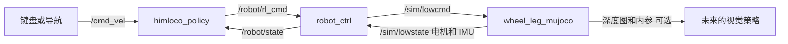

# 仿真、策略与主控的包结构

本工作空间把仿真和策略拆成两个独立 ROS2 包。主控仍为 `robot_ctrl`，负责状态机、指令校验和电机接口。原 `himloco_sim2sim` 包的功能已按职责迁移，不再保留旧包入口。

## 1. 各包负责什么

| 位置 | 职责 | 主要入口 |
| --- | --- | --- |
| `src/wheel_leg_mujoco` | 加载机器人/场景，推进物理仿真，执行电机 PD，发布电机与 IMU，按需渲染深度 | `ros2 launch wheel_leg_mujoco mujoco.launch.py` |
| `src/himloco_policy` | 组装 HIMLoco 观测，维护历史，执行模型推理，输出 16 路关节目标 | `ros2 launch himloco_policy policy.launch.py` |
| `src/robot_ctrl` | Passive/Stand/RL 状态机、会话检查、超时和倾角保护、RobotIO，以及通用键盘速度节点 | `ros2 launch robot_ctrl robot_ctrl.launch.py` |
| `src/wheel_leg_interfaces` | 与硬件无关的 `RobotState`、`RobotCommand` 消息 | 由主控和策略共同使用 |
| 根目录 `launch/` | 组合上述节点，同步 profile 和话题参数 | `ros2 launch launch/dog_mujoco.launch.py` |
| 根目录 `start_sim.sh` | source 环境、首次编译、启动障碍仿真、选择键盘或固定速度 | `./start_sim.sh` |

`wheel_leg_mujoco` 不导入策略模块，也不依赖 Torch。`himloco_policy` 不导入 MuJoCo，也不依赖仿真包。`robot_ctrl` 不依赖这两个功能包，`RobotIO` 是主控内部的 C++ 类。

仿真资源位于 `src/wheel_leg_mujoco/models/go2w`，构建后安装至 `share/wheel_leg_mujoco/models/go2w`。机器人、平地和障碍场地均从本仓库加载，无需外部 `dogMujoco2027` 工程。

## 2. 数据如何流动



主控以 200 Hz 读取反馈、执行 FSM 和保护，再通过 RobotIO 输出命令。策略以 50 Hz 推理；MuJoCo 以 0.005 s 步长推进物理。策略不直接给仿真器发送电机命令。

| 默认 topic（`dog_mujoco.launch.py`） | 发布者 → 订阅者 | 消息 |
| --- | --- | --- |
| `/cmd_vel` | 键盘/导航 → 策略 | `geometry_msgs/msg/Twist` |
| `/robot/state` | 主控 → 策略 | `wheel_leg_interfaces/msg/RobotState` |
| `/robot/rl_cmd` | 策略 → 主控 | `wheel_leg_interfaces/msg/RobotCommand` |
| `/robot/mode` | 策略自动启动/操作者 → 主控 | `std_msgs/msg/String` |
| `/sim/lowcmd` | 主控 → 仿真 | `unitree_go/msg/LowCmd` |
| `/sim/lowstate` | 仿真 → 主控 | `unitree_go/msg/LowState`，包含电机和 IMU |
| `/robot/imu` | 主控 → 其他模块 | `sensor_msgs/msg/Imu` |
| `/sim/camera/depth/image_raw` | 仿真 → 主控缓存/视觉策略 | `sensor_msgs/msg/Image`，32FC1，米 |
| `/sim/camera/depth/camera_info` | 仿真 → 主控缓存/视觉策略 | `sensor_msgs/msg/CameraInfo` |

电机和 IMU 的单位、顺序、坐标系约定与拆分前一致。当前策略为盲走模型，只消费 `/robot/state` 与期望速度；不会因为启用深度话题就自动获得视觉能力。后续视觉策略可直接订阅相机话题，不需要先把整张图像塞进主控状态消息。

当前 XML 只有场地观察相机，没有默认名为 `front_depth` 的机载相机。深度发布默认关闭；启用前应先按训练配置在机器人模型下添加相机，并配置相机名称和内参。

## 3. 构建与完整启动

以下命令在工作空间根目录执行：

```bash
source /opt/ros/humble/setup.bash
colcon build --packages-up-to robot_ctrl wheel_leg_mujoco himloco_policy \
  --cmake-args -DBUILD_TESTING=OFF
source install/setup.bash
source .venv/bin/activate

# 与原脚本相同，默认 parkour + 障碍场地 + 跟随相机。
./start_sim.sh

# 不打开窗口，不启用键盘，持续发送固定前进速度。
VIEWER=false ENABLE_KEYBOARD=false VX=0.6 ./start_sim.sh

# 从 ROS2 启动平地，选择 parkour 参数。
ros2 launch launch/dog_mujoco.launch.py \
  policy_profile:=parkour enable_keyboard:=true viewer:=true
```

`start_sim.sh` 自动 source ROS2、当前工作空间和 `.venv`；首次运行会构建，修改源码后可设置 `BUILD=true`。

两个 Python 包的运行依赖分别列在各自的 `requirements.txt` 中。仿真进程需要 NumPy 和 MuJoCo；策略进程需要 NumPy 和 Torch。完整仿真环境安装两份：

```bash
python -m pip install -r src/wheel_leg_mujoco/requirements.txt \
  -r src/himloco_policy/requirements.txt
```

`enable_keyboard` 这个 ROS2 参数默认仍为 `false`；一键脚本显式设为 `true`，便于交互。方向键控制前后左右，`,`、`.` 控制左/右转，空格停止。

## 4. 分别启动三个节点

在每个终端 source ROS2、工作空间和相应的 Python 环境，然后执行：

```bash
# 终端一：只启动仿真。初始姿态选择 parkour。
ros2 launch wheel_leg_mujoco mujoco.launch.py \
  config_file:="$(ros2 pkg prefix wheel_leg_mujoco)/share/wheel_leg_mujoco/config/parkour.yaml" \
  viewer:=true

# 终端二：只启动主控；话题和仿真一致，站姿选 parkour。
ros2 launch robot_ctrl robot_ctrl.launch.py \
  control_profile:=parkour \
  motor_command_topic:=/sim/lowcmd motor_state_topic:=/sim/lowstate \
  depth_topic:=/sim/camera/depth/image_raw \
  camera_info_topic:=/sim/camera/depth/camera_info

# 终端三：只启动策略；autostart 负责请求 Stand，然后请求 RL。
ros2 launch himloco_policy policy.launch.py policy_profile:=parkour autostart:=true

# 可选：第四个终端发布期望速度。
ros2 run robot_ctrl keyboard_control --ros-args -p enable_keyboard:=true
```

独立策略 launch 的 `autostart` 默认 `false`。未启用时由操作者通过 `/robot/mode` 请求 `stand`，站立完成后请求 `rl`。没有反馈时主控会禁用输出；仅启动策略无法产生有效电机闭环。

仿真独立 launch 默认使用 flat 初始姿态；控制器独立 launch 默认 `control_profile:=flat`；策略独立 launch 默认 `policy_profile:=parkour`。分别启动时应主动对齐三个配置，避免初始站姿和训练基准不一致。

## 5. 配置归属与关键代码

| 参数/功能 | 文件 |
| --- | --- |
| 机器人 XML、场景、物理步长、关节映射、力矩执行、IMU 生成 | `src/wheel_leg_mujoco/wheel_leg_mujoco/mujoco_backend.py` |
| ROS2 电机收发、命令看门狗、窗口跟随、深度发布 | `src/wheel_leg_mujoco/wheel_leg_mujoco/mujoco_node.py` |
| 仿真初始站姿、初始高度 | `src/wheel_leg_mujoco/config/{parkour,flat}.yaml` |
| 观测布局、历史、动作缩放与腿/轮分流 | `src/himloco_policy/himloco_policy/policy_core.py` |
| 模型路径、推理周期、速度超时、ROS 状态收发 | `src/himloco_policy/himloco_policy/policy_node.py` 与 `config/himloco.yaml` |
| 策略默认姿态与 RL 指令 PD | `src/himloco_policy/config/{parkour,flat}.yaml` |
| Stand/等待首条 RL 指令的姿态与 PD | `src/robot_ctrl/config/{parkour,flat}.yaml` |
| 电机映射、反馈超时、底层电机/相机 topic | `src/robot_ctrl/config/go2w.yaml` |
| 键盘开关、速度和按键超时 | `src/robot_ctrl/config/keyboard.yaml` |
| Passive/Stand/RL 与模式切换 | `src/robot_ctrl/src/FSM/` |
| 状态读取、电机与 IMU 的 ROS2 接口 | `src/robot_ctrl/src/interface/RobotIO.cpp` |

组合启动的 `policy_profile` 同时选择三个包中各自的 profile 文件。它们分别只包含所属节点的参数，互不导入。parkour 的腿 kp/kd 为 40/1，轮 kd 为 0.5；flat 为 20/0.5、0.3。正式 RL 时每条 `RobotCommand` 自带 PD，Stand 的 PD 不会覆盖策略命令。更换训练模型时，应同时检查三个配置与训练环境中的姿态、控制周期、动作缩放和 PD。

详细的 IMU 坐标系、PD 公式、调整方法和消息字段见 [控制实现与策略接入笔记](control_and_policy_integration.md)。

## 6. 换策略与 sim2real

使用自己的策略进程时，关闭默认 HIMLoco 节点：

```bash
ros2 launch launch/dog_mujoco.launch.py start_policy:=false autostart:=false
```

这个选项保留仿真与主控，主控初始为 Passive。外部策略应订阅 `/robot/state`，发布 `/robot/rl_cmd`，遵守时间戳、会话号、电机顺序和有效值检查，并请求 Stand/RL。启动前必须确保只有一个策略发布电机目标。新的视觉策略也遵守同一电机接口，另行订阅相机即可。

接真实驱动时，可以在开发机使用组合启动并关闭仿真：

```bash
ros2 launch launch/dog_mujoco.launch.py \
  start_simulator:=false autostart:=false \
  motor_command_topic:=/hardware/lowcmd motor_state_topic:=/hardware/lowstate \
  depth_topic:=/hardware/camera/depth/image_raw \
  camera_info_topic:=/hardware/camera/depth/camera_info
```

组合 launch 位于工作空间根目录，生成启动描述时仍会查找两个功能包。只部署实机的软件环境时，可以仅构建并独立启动 `robot_ctrl`、`himloco_policy`，不安装 `wheel_leg_mujoco` 或 MuJoCo。主控设置实际硬件 topic，策略保持相同接口。

硬件驱动负责电机 SDK/总线协议以及真实 IMU 数据；需提供兼容的 `LowCmd/LowState`，或在驱动层转换。更换 topic 之前应对齐电机槽位、单位、IMU 朝向、PD/CRC 和独立底层看门狗。当前没有实现真实电机驱动、定位融合或实机验证；包拆分不改变这些边界。
